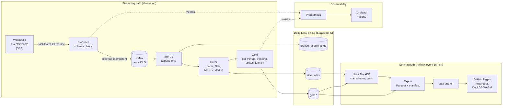

# Architecture

Two paths: a **streaming path** that turns every Wikipedia edit into Delta tables within seconds, and a **serving path** that every 15 minutes turns those tables into a tested star schema and a static public dashboard.

## Delivery guarantees, hop by hop

| Hop | Guarantee | Mechanism | Verified by |
|---|---|---|---|
| Feed → producer | resume without gaps | SSE `Last-Event-ID`, checkpointed only after Kafka acks | 3.8 h and 21 h runs including a 16 h outage: 0 gaps over 10 s |
| Producer → Kafka | at-least-once | `acks=all`, idempotent producer, checkpoint after `flush()` | kill tests: replays appear, holes don't ([ADR 0001](decisions/0001-kafka-between-feed-and-spark.md)) |
| Kafka → Bronze | exactly-once | offsets in the Spark checkpoint + Delta sink batch IDs | audit: every offset once, after SIGKILL of everything |
| Bronze → Silver | exactly-once, nothing dropped for lateness | insert-only MERGE on `edit_id` with `txnAppId`/`txnVersion` | audit + [incident report](incidents/2026-10-20-silver-late-drops.md) |
| Silver → Gold | exactly-once | incremental MERGE with `txnAppId`/`txnVersion` ([ADR 0004](decisions/0004-watermarks-and-gold-windowing.md)) | Gold = Silver recount on 60k wiki-minutes, across OOM crashes |
| Gold → dashboard | only tested data is published | export runs only when `dbt test` passes (Airflow Dataset) | DAG wiring |

## Components

| Concern | Choice | Notes |
|---|---|---|
| Ingestion | Python producer (`producer/`) | JSON-schema validation, dead-letter topic, Prometheus metrics |
| Broker | Kafka 3.9 (KRaft) | 3 partitions keyed by wiki, 7-day retention |
| Processing | Spark 3.5 Structured Streaming | Bronze, Silver and Gold as 3 queries in one app (`streaming/pipeline.py`), FAIR pools |
| Storage | Delta Lake 3.2 on SeaweedFS (S3 API) | [ADR 0002](decisions/0002-seaweedfs-instead-of-minio.md), [ADR 0008](decisions/0008-delta-lake-over-iceberg.md) |
| Analytics | dbt-duckdb, DuckDB reading Delta in place | star schema, SCD2 users, 29 tests |
| Quality | dbt tests, Great Expectations, hourly lake audit | the audit fails the DAG on any lost or duplicate event |
| Orchestration | Airflow 2.10 (LocalExecutor) | 5 DAGs; maintenance requested, run by the single writer ([ADR 0006](decisions/0006-maintenance-requests-and-lag-metrics.md)) |
| Monitoring | Prometheus + Grafana | lag computed from Spark progress, latency histogram, 6 alert rules |
| Dashboard | static site on GitHub Pages | hyparquet for panels, DuckDB-WASM on demand ([ADR 0007](decisions/0007-dashboard-renders-with-hyparquet.md)) |

## Where each decision is recorded

| ADR | Decision |
|---|---|
| [0001](decisions/0001-kafka-between-feed-and-spark.md) | Kafka between the feed and Spark; at-least-once producer |
| [0002](decisions/0002-seaweedfs-instead-of-minio.md) | SeaweedFS instead of MinIO (images no longer published) |
| [0003](decisions/0003-silver-partitioned-by-date-only.md) | Silver partitioned by date only, to avoid small files |
| [0004](decisions/0004-watermarks-and-gold-windowing.md) | No watermarks; Gold by idempotent incremental MERGE |
| [0005](decisions/0005-spike-definition.md) | Spike rule: z > 3, ≥ 5 edits, ≥ 2 editors |
| [0006](decisions/0006-maintenance-requests-and-lag-metrics.md) | Maintenance requested by Airflow, run by the Spark app; lag from Spark progress |
| [0007](decisions/0007-dashboard-renders-with-hyparquet.md) | Dashboard renders with hyparquet; DuckDB-WASM on demand |
| [0008](decisions/0008-delta-lake-over-iceberg.md) | Delta Lake rather than Iceberg |
